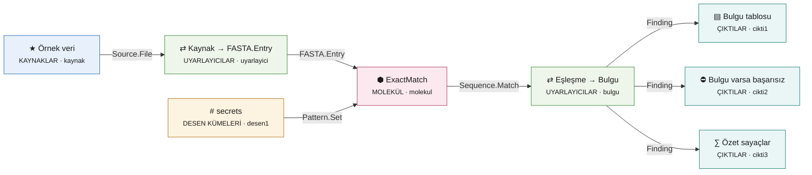

# Akıllı Tam Desen Eşleştirme ve Kod Bilimi Atölyesi (IoS: `sequence.pattern-match.exact`)

[](https://github.com/Baki-B/YZM327-Odev-3/actions/workflows/testler.yml) [](https://github.com/Baki-B/YZM327-Odev-3/actions/workflows/codeql.yml) [](https://github.com/Baki-B/YZM327-Odev-3/actions/workflows/tarama.yml) [](https://github.com/Baki-B/YZM327-Odev-3/actions/workflows/sayfalar.yml) · Lisans: [MIT](LICENSE) · [Değişiklik günlüğü](CHANGELOG.md) · [Katkı rehberi](CONTRIBUTING.md) · [Güvenlik](SECURITY.md)

**Canlı site:** <https://baki-b.github.io/YZM327-Odev-3/> · atölye: [`web/`](https://baki-b.github.io/YZM327-Odev-3/web/) · sunum: [`docs/sunum/`](https://baki-b.github.io/YZM327-Odev-3/docs/sunum/) · rapor: [`docs/rapor/Rapor.pdf`](docs/rapor/Rapor.pdf)

Vize projesi (grup çalışması). Bir metinde (genom, protein, kaynak kod, log) bir ya da daha çok desenin geçtiği bütün yerleri bulan **yedi yeni atom** (+ Boyer-Moore), girdinin şekline bakıp en hızlısını seçen **ExactMatch molekülü** ve bunları yazılım mühendisliğinde kullanan tarayıcı tabanlı bir iş akışı düzenleyicisi: **Kod Bilimi Atölyesi**. Seçim, ölçümle kalibre edilmiş bir maliyet modeliyle yapılır.

**Sonuç (model v4, kalibrasyonda ve hiçbir kararda kullanılmamış taze kümeler, birer kez ölçüldü):**

- **Çok desen (D, 120 vaka):** molekülün seçtiği atom %76,7 en hızlı, %84,2 en hızlının %10 yakınında; yavaşlamanın geometrik ortalaması **1,051**, en kötü **2,00×**. Karar süresi dahil **uçtan uca**: **0,990**, en kötü 3,26×. En iyi tek atom (hep Wu-Manber) 1,131 ve 2,78×; Allmer 2016 kuralı 2,543 ve 18,71×.
- **Tek desen (E, 120 vaka):** seçilen atomla 1,081, en kötü 2,06×; uçtan uca 1,300. Burada molekül uçtan uca hep Horspool (1,198) ve Allmer kuralının (1,192) gerisinde.
- **Karar yükü:** v3'te karar için metin 262 144 karaktere kadar sayılıyordu; v4 en fazla 64 × 256 karakter sayar. Şekil hesabı D'de medyanda 0,648 ms'den 0,063 ms'ye indi; karar süresi / seçilen atomun süresi medyanda %4,1 (D), %11,4 (E). Uçtan uca oranın 1'in altına düşmesi ölçüm sapmasıdır (molekül, kendi seçtiği atomdan medyanda kısa ölçüldü: 0,951); bu yüzden karar süresi ayrıca ölçüldü.
- v3 (A, B, C) ile v4 (D, E) farklı makinelerde ölçüldü; yeni makine aynı ölçümleri medyanda 1,74 kat yavaş yaptı. Ayrıntı: rapor bölüm 6–7, [bench/results/makine-karsilastirma.md](bench/results/makine-karsilastirma.md).

## Öne çıkanlar

- **Atölye** (tarayıcıda, kurulumsuz): türlü uçlarla iş akışı kurma; uyumsuz bağlantı nedeniyle reddedilir. **Geri al / yinele** (Command deseni; paket açma dahil), **önbellek** (değişmeyen kutu yeniden çalışmaz; bir ayar değişince yalnızca o kutu ve ondan sonrakiler), **otomatik yerleşim** ("Düzenle": katmanlı çizim, kesişen kabloları azaltır, tek adımda geri alınır), kopyala-yapıştır-çoğalt, **canlı denetim** (bağlanmamış ya da sonucu kullanılmayan kutu), otomatik kayıt, kısayol penceresi, Mermaid diyagramı ve **çalıştırma kaydı** (bileşen sürümleri, girdilerin SHA-256 özetleri, kararlar) indirme.
- **`ios scan`**: birden çok hazır küme, **SARIF** çıktısı (GitHub kod tarama ekranı), kural kimliği / önem / CWE, satır içi bastırma (`ios:ignore`), `.iosignore`, **taban çizgisi** (yalnızca yeni bulgular), tam sözcük, gizli bilgi değerlerini maskeleme. Atölyedeki "SARIF indir" kutusu birebir aynı dosyayı üretir.
- **`ios workflow run | lint | diagram`**: atölyede kurulan iş akışı CI'da tarayıcısız çalışır; kapı kalırsa çıkış kodu 1.
- **Kalite kapıları** (her gönderimde GitHub Actions): 487 birim testi (Node 22 ve 24), kapsama satır %99,5 / dal %91,4 / işlev %98,0 statik tür denetimi 0 hata (ilk ölçümde 138; rol arayüzleri derleme anında da denetlenir, 11 olumsuz kontrol), gerçek tarayıcıda 54/54 arayüz denetimi, WCAG 2.1 AA erişilebilirlik 0 ihlal (ilk ölçümde 25), mutasyon denetimi, CodeQL ve kendi tarayıcımızla depo taraması. Ayrıntı: [site/kalite.html](site/kalite.html), [docs/kalite/](docs/kalite/).
- **Benzer projeler**: GitHub'da en çok yıldız alan iş akışı düzenleyicileri, bilimsel iş akışı yöneticileri ve kod tarayıcıları incelendi; alınan ve alınmayan fikirler gerekçesiyle: [docs/benzer-projeler.md](docs/benzer-projeler.md).

Örnek: "gizli bilgi sızıntısı" paketi (`node bin/ios.js workflow diagram is-akisi.json` çıktısı; GitHub bu diyagramı çizer):



## Teslim parçaları

| Parça | Nerede |
|---|---|
| **Rapor** | [docs/rapor/Rapor.pdf](docs/rapor/Rapor.pdf): IoS bileşen yayını biçiminde 8 bölüm (ana metin 5 sayfa) + ekler (gereksinimler, SOLID, test stratejisi, UML) |
| **Sunum** | [docs/sunum/index.html](docs/sunum/index.html): 10 slayt, ← → ile ilerler, `P` ile PDF'ye yazdırılır; konuşma notları [docs/sunum.md](docs/sunum.md) |
| **Site** | [site/index.html](site/index.html): ana sayfa, atölye, bileşenler (her bileşen için yayın sayfası), sonuçlar, kalite, rapor, ekip |
| **Atölye** | [web/index.html](web/index.html): iş akışı düzenleyicisi (aşağıda nasıl açılacağı) |
| **UML** | [docs/uml/](docs/uml/README.md): kullanım durumu, 4 sınıf, 4 sıralı, paket diyagramı; tek dosyada [UML_Diyagramlari.pdf](docs/uml/UML_Diyagramlari.pdf) |
| **GitHub** | bu depo; commit geçmişi |

| Belge | İçinde |
|---|---|
| [bench/results/validation-d.md](bench/results/validation-d.md) | **Doğrulama tablosu**, v4, çok desen (D) |
| [bench/results/validation-e.md](bench/results/validation-e.md) | v4, tek desen (E) |
| [bench/results/karar-yuku-v4.md](bench/results/karar-yuku-v4.md) | Karar süresinin doğrudan ölçümü, örneklem doğruluğu |
| `validation-taze.md`, `validation-tek.md`, `validation.md`, `validation-v1.md`, `validation-v2.md` | Eski sürümlerin kümeleri (B, C, A); silinmedi |
| [bench/results/calibration-fit.md](bench/results/calibration-fit.md) | Kalibrasyon katsayıları (v4); v3: `calibration-fit-v3.md` |
| [docs/sapmalar.md](docs/sapmalar.md) | Allmer 2016'dan ve klasik tariflerden sapmalar |
| [docs/mutasyon.md](docs/mutasyon.md) | Mutasyon denetimi |
| [docs/anlatim.md](docs/anlatim.md) | Her dosyanın, atölyenin ve iş akışı motorunun sade anlatımı |
| [docs/kontrol.md](docs/kontrol.md) | Ödev kontrol listesi |
| [KARARLAR.md](KARARLAR.md) | Ödev metninin açık bıraktığı noktalarda ve tasarımda verilen kararlar |
| [docs/benzer-projeler.md](docs/benzer-projeler.md) | GitHub'daki benzer projeler, alınan ve alınmayan fikirler |
| [docs/kalite/](docs/kalite/) | Kalite kapılarının sonuçları: kapsama, tür denetimi, arayüz, erişilebilirlik, bağlantı; ilk ölçümler |
| [CHANGELOG.md](CHANGELOG.md), [CONTRIBUTING.md](CONTRIBUTING.md), [SECURITY.md](SECURITY.md) | Değişiklik günlüğü, katkı rehberi (yeni atom / kural / kutu nasıl eklenir), güvenlik politikası ve tehdit modeli |

## Kurulum

Node.js 22 ya da üstü yeterlidir. Hiçbir npm paketi kullanılmaz; `npm install` gerekmez.

```bash
node --version
```

## Atölyeyi, siteyi ve sunumu yerelde açmak

Atölye ES modülleri ve Web Worker kullandığı için `file://` ile değil, bir sunucudan açılmalıdır. Depoda bağımlılıksız bir sunucu var (yalnızca Node'un kendi modülleri, yalnızca 127.0.0.1):

```bash
npm run web
```

Sonra tarayıcıda: atölye `http://localhost:8327/web/`, site `http://localhost:8327/site/`, sunum `http://localhost:8327/docs/sunum/`. Başka bir bağlantı noktası için: `node scripts/sunucu.js --port 9000`.

Atölyede: soldan bir hazır paket seçin (ya da bileşenleri tuvale sürükleyip uçlarını bağlayın) ve **Tarayıcıda çalıştır**'a basın. ExactMatch kutusunu seçince molekülün karar kaydı (`explain`) sağ panelde görünür; **Açıkla** iş akışını Türkçe cümlelerle anlatır; **Atomları yarıştır** aynı girdide bütün atomları tarayıcıda ölçer (gösterim amaçlı; rapordaki sayılar Node ölçümleridir). Kutu ekleme, taşıma ve bağlama klavyeyle de yapılır. Kısayollar: Ctrl+Enter çalıştır, Ctrl+Z / Ctrl+Shift+Z geri al / yinele, Ctrl+D çoğalt, Ctrl+C / Ctrl+V kopyala / yapıştır, `?` bütün kısayollar. **Denetim** sekmesi iş akışındaki sorunları çalıştırmadan önce listeler; **Özet** sekmesinden çalıştırma kaydı, **Açıklama** sekmesinden Mermaid diyagramı indirilir. Son iş akışı bu tarayıcıda otomatik saklanır; bir JSON iş akışı dosyasını tuvale bırakmak onu açar.

Hazır paketler: teknik borç avı, gizli bilgi sızıntısı (+ CI kapısı), yasaklı / riskli API, log incelemesi, tek desen / büyük dosya, biyoloji köprüsü (lambda genomu). Her birinin bulgu sayısı komut satırıyla aynıdır (`npm run paketler`).

## Komutlar

| Komut | Ne yapar |
|---|---|
| `npm test` | 487 birim testi: sözleşme, özel durumlar, oracle karşılaştırması, molekül, iş akışı motoru, geri al / yinele (özellik tabanlı), denetim, tarama kuralları ve SARIF, roller, görünüm modelleri ve sahte DOM'la öğe kurma, hazır paketler, komut satırı, yasaklı işlev taraması |
| `npm run kapsama` | Test kapsaması (Node'un yerleşik ölçümü; eşik: satır %95, dal %85, işlev %95) → `docs/kalite/kapsama.md` |
| `npm run tur-denetimi` | Statik tür denetimi (`tsc --checkJs`; TypeScript geçici kurulur: `npm install --no-save --no-package-lock typescript@6.0.3 @types/node@22`) |
| `npm run calibrate` | Kalibrasyon ızgarasını ölçer (180 vaka × 8 atom), katsayıları `src/molecules/coefficients.json` ve `.js`'e yazar (bu makinede 233,9 s) |
| `npm run bench` | Doğrulama kümesi A. Taze kümeler: `node --expose-gc tests/benchmarks/validate.js --seed 16180339 --name validation-d` (D) ve `... --seed 14142135 --name validation-e --k 1` (E). `--retable` ölçüm yapmadan tabloları yeniden kurar |
| `npm run karar-yuku` | Karar süresinin doğrudan ölçümü ve örneklem doğruluğu → `bench/results/karar-yuku-v4.md` |
| `npm run figures` | Rapor şekilleri (`docs/rapor/*.svg`) |
| `npm run mutation` | Mutasyon denetimi (25 bilerek konmuş hata) → `docs/mutasyon.md` |
| `npm run web` | Bağımlılıksız yerel sunucu (atölye, site, sunum) |
| `npm run paketler` | Hazır paketleri iş akışı motoruyla çalıştırıp komut satırıyla karşılaştırır (Agora örneğini `web/data/agora.json`'dan `ornek-agora/` klasörüne açar) |
| `npm run ornekler` | Atölyenin örnek verilerini gerçek dosyalardan üretir (`web/data/`; Agora örneği yalnızca Agora kaynağı yanındayken yenilenir) |
| `node scripts/agora-ac.js` | Agora örneğini (`web/data/agora.json`, 114 dosya) `ornek-agora/` klasörüne gerçek dosyalar olarak açar |
| `node scripts/site-uret.js` | Siteyi ve slaytları `bench/results/`'tan üretir (sayılar elle yazılmaz) |
| `node scripts/uml-ciz.js --pdf` | UML diyagramları (`docs/uml/`) |
| `node scripts/sayi-denetimi.js` | Rapor, README, sunum, site ve kontrol listesindeki her sayıyı kaynak dosyalara karşı denetler |
| `node scripts/arayuz-denetimi.js` | Atölyenin gerçek Chromium'da uçtan uca denetimi (Playwright gerekir), ekran görüntüleri `docs/ekran/` |
| `node scripts/erisilebilirlik-denetimi.js` | Atölye, site ve sunumda WCAG 2.1 AA denetimi (Playwright + axe-core) → `docs/kalite/erisilebilirlik.md` |
| `node scripts/baglanti-denetimi.js` | Site, sunum ve atölyede kırık bağlantı denetimi |
| `npm run report` | `docs/rapor/rapor.html` → `Rapor.pdf` (Playwright gerekir) |

Ölçüm yaparken makinede başka ağır iş çalışmamalı. Sonuçlar makineye bağlıdır: teslimden önce `npm run calibrate` ve ardından taze kümeler kendi bilgisayarınızda yeniden çalıştırılabilir (yeni tohumla; eski sonuçlar silinmeden).

## Komut satırı

```bash
node bin/ios.js run ExactMatch --patterns GATC,GGATCC --strategy auto < tests/data/lambda_NC_001416.fa > cikti.jsonl
```

```bash
node bin/ios.js explain --patterns GATC,GGATCC < tests/data/lambda_NC_001416.fa
```

```bash
node scripts/agora-ac.js
```

```bash
node bin/ios.js scan --preset todo ornek-agora/forum
```

- `run`: stdout'a satır başına bir `Sequence.Match` (JSONL) yazar; karar özeti stderr'e gider. Bileşen adı `ExactMatch` ya da bir atomun adı olabilir.
- `explain`: yalnızca molekülün kararını (`record`) JSON olarak yazar.
- `scan`: dosya ya da klasörlerde arar; çıktı `dosya:satır:sütun: desen`. Hazır kümeler: `todo`, `secrets`, `banned-api`, `errors` (virgülle birden çok). Seçenekler: `--format text|json|sarif` (`--json`, `--sarif` kısaltmaları), `--fail` (bulgu varsa çıkış kodu 1), `--word` (tam sözcük), `--no-inline-ignore`, `--ignore-file <yol>` (varsayılan `./.iosignore`), `--baseline <eski.sarif>` (yalnızca yeni bulgular), `--no-redact`.
- `workflow run | lint | explain | diagram <is-akisi.json>`: atölyede "Dışa aktar" ile indirilen iş akışını tarayıcısız çalıştırır, denetler, anlatır ya da Mermaid / DOT diyagramını yazar.
- `list`: kayıtlı atomları listeler.
- Çıkış kodları: 0 başarılı · 1 bulgu var (`--fail`), kapı kaldı, denetimde hata ya da çalışma hatası · 2 kullanım hatası.

Bir satırı bilerek bırakmak için satıra `ios:ignore`, bir üst satıra `ios:ignore-next-line` yazılır (gitleaks'teki `gitleaks:allow`, ESLint'teki `eslint-disable-next-line` gibi). Sürekli entegrasyonda yalnızca yeni bulgularla kalmak için:

```bash
node bin/ios.js scan --preset secrets,banned-api --format sarif . > taban.sarif
```

```bash
node bin/ios.js scan --preset secrets,banned-api --baseline taban.sarif --fail .
```

Kod içinden kullanım:

```js
import { ExactMatch } from './src/molecules/ExactMatch.js';
const em = new ExactMatch({ patterns: ['ACGT', 'GGCC'], ignoreCase: false, strategy: 'auto' });
for (const match of em.run(entries)) console.log(match);
console.log(em.record); // { requested, selected, shape, estimates, why }
```

## Depo yapısı

```
src/functions/   algoritma çekirdekleri (saf; yalnızca sayı dizileri üzerinde çalışır)
src/atomic/      atom sınıfları: manifest + selection + process (ExactSearchAtom ortak sınıf)
src/molecules/   ExactMatch.js (molekül), costModel.js (tahmin + NNLS), coefficients.json/.js
src/registry.js  kayıt defteri: yeni atom eklemek molekülü değiştirmez
src/contracts.js rol arayüzleri: Describable, Searcher, SelectionProvider, WorkflowComponent (tsc + çalışma anı)
src/shape.js     veri şekli: n, σ, σe, k, mMin, mMax, mMean (64 × 256 karakterlik örneklem)
src/adapters/    kaynak dosya → FASTA.Entry uyarlayıcısı
src/workflows/   iş akışı motoru (engine), katalog, geçmiş (history), denetim (lint), diyagram,
                 çalıştırma kaydı (provenance), hazır paketler, atom yarışı, CodeScan
src/scan/        tarama kuralları (kimlik, önem, CWE), süzgeçler, parmak izi, maskeleme, SARIF
bin/ios.js       komut satırı
web/             Kod Bilimi Atölyesi: app.js (giriş), state.js, actions.js + actions/ (denetleyici),
                 views/ (görünümler), lib/ (DOM'suz yardımcılar), keyboard.js, runner/worker/core
site/            proje sitesi (scripts/site-uret.js ile üretilir)
bench/           veri üretici, zaman ölçümü, kod korpusu, sonuçlar (results/)
tests/unit/      birim testleri (npm test)
tests/benchmarks/ kalibrasyon, doğrulama, ölçütler, şekiller
tests/data/      gerçek veri (lambda faj genomu, 126 E. coli K-12 proteini); kurallar/ işaretli örnekler
docs/            rapor, sunum, UML, kalite sonuçları, benzer projeler, sapmalar, mutasyon, anlatım
scripts/         sunucu, örnek veri, paket karşılaştırması, site/UML üretimi, denetimler, PDF
types/           tür denetimi için genel bildirimler (çalışan koda girmez)
.github/         CI iş akışları, CodeQL, kendi taramamız, Dependabot, konu ve PR şablonları
```

## Depo ve geçmiş

Proje ilk olarak `Baki-B/YZM327-Odevler` deposunun `vize/` klasöründe geliştirildi. Ödevin beklediği kök düzeni (`src/`, `bin/`, `package.json` depo kökünde) için o klasörün geçmişi `git subtree split --prefix=vize` ile ayrılıp bu depoya taşındı: `vize/` klasörünü değiştiren her commit, yol önekleri atılmış hâliyle buradaki geçmişte yer alır. Proje Agora'nın kaynak koduna bağlı değildir; Agora örneği (`web/data/agora.json`) ve kaynak kod korpusu (`bench/corpus/kod.txt`) depoya dahildir.

Teslim .zip olarak isteniyorsa:

```bash
git archive --format=zip -o kod-bilimi-atolyesi.zip HEAD
```

## GitHub Pages'te yayınlama

Yayın adresi: **<https://baki-b.github.io/YZM327-Odev-3/>** (kökteki `index.html` siteye yönlendirir).

`.github/workflows/sayfalar.yml`, `main` dalına her gönderimde Node 22 ile `npm test` çalıştırır; testler geçmezse yayımlamaz. Geçerse depoyu olduğu gibi siteye koyar ve yayınlar; Actions sekmesinden elle de başlatılabilir. Site, atölye, sunum ve rapor statik dosyalardır ve göreli yollarla çalışır; derleme adımı yoktur.

Diğer iş akışları (`.github/workflows/`):

| İş akışı | Ne zaman | Ne yapar |
|---|---|---|
| `testler.yml` | her gönderim ve pull request | birim testleri (Node 22 ve 24), paket eşitliği, kapsama eşiği, tür denetimi, tarayıcıda arayüz + bağlantı + erişilebilirlik denetimi, belgelerdeki sayıların denetimi |
| `codeql.yml` | `main`, pull request, haftalık | CodeQL statik güvenlik analizi |
| `tarama.yml` | `main`, pull request | kendi tarayıcımızla depo taraması: gizli bilgi kapısı + SARIF'in GitHub kod tarama ekranına yüklenmesi |
| `dependabot.yml` | haftalık | Actions sürümlerinin güncellenmesi |

Pages ilk kez açılırken iş akışı Pages'i kendisi etkinleştirmeyi dener. Bu başarısız olursa bir kez elle yapın: depo **Settings → Pages → Build and deployment → Source: "GitHub Actions"**, ardından **Actions → GitHub Pages → Run workflow**.

## Veri kaynakları

- **Lambda faj genomu:** NC_001416.1, 48 502 baz. `tests/data/lambda_NC_001416.fa` (bowtie2 deposundaki örnek dosya, NCBI kaydının kopyası).
- **E. coli K-12 proteinleri:** 126 UniProtKB/Swiss-Prot kaydı (OX=83333; UniProt verileri CC BY 4.0). `tests/data/ecoli_k12_126_proteins.fasta`; her kaydın kaynağı `.kaynak.tsv` dosyasında.
- **Kaynak kod korpusu:** bu deponun Agora projesi (`forum/`, `testler/`, `tarayici/`, `olcum/`, `laboratuvar/`) → `bench/corpus/kod.txt`.
- **Atölye örnekleri** (`web/data/`, `npm run ornekler`): Agora `forum/` klasörü (114 dosya), bench/data.js log üreticisinden örnek log (+ 3 elle yazılmış örnek Traceback bloğu), açıkça **sahte** gizli bilgi örnekleri (gerçek anahtar yok; AKIA ile başlayan değer AWS belgelerindeki resmî örnek anahtardır).

## Başlangıç paketi

Paket verilmedi; karşılığı ödevin 4. ve 5. bölümüne göre yazıldı (`ExactSearchAtom`, `NaiveSearch`, `BoyerMooreSearch`, `alphabet.js`, `hits.js`, `fasta.js`, `bench/data.js`, `bench/timing.js`, `contract.test.js`). Proje kendi başına çalışır.

## Yol haritası (geliştirilebilecek noktalar)

Benzer projelerden alınmayıp sonraya bırakılanlar ([docs/benzer-projeler.md](docs/benzer-projeler.md), "gelecek iş") ve bilinen sınırlar (rapor, Bölüm 7 ve Ek C.7):

- **Atölye:** mini harita (xyflow).
- **Tarama:** düzenli ifade ve entropi tabanlı gizli bilgi kuralları (boşluklu `password = "x"` atamasını da yakalar; detect-secrets); `.gitignore`'un tam anlamı; iş notlarını iş kaydına (issue) çevirme (todo-to-issue); büyük loglar için akış (streaming) kipi (Hyperscan); en uzun eşleşme süzgeci (aho-corasick).
- **Molekül:** her kayıt için yeniden karar seçeneği (sözleşme kararı ilk kayda göre ister); kelime yapılı metin ve ikili alfabe için yeni şekil özellikleri; öğrenen bir seçiciyle (karar ağacı) karşılaştırma; tarayıcıda kalibrasyon.
- **Test:** tuval etkileşimleri (sürükleme, yakınlaştırma) için birim testleri; arayüzün mantığı görünüm modellerinde birim testli, bu etkileşimler şimdilik yalnızca gerçek tarayıcıdaki arayüz denetimiyle sınanıyor.
- **IoS hub:** hub.ioscience.org erişilebildiğinde iş akışlarını onun biçimine aktarma.
- Bilerek alınmayan: trufflehog'un bulunan anahtarı servise sorarak doğrulaması (atomlarda ağ yasak; başkasının anahtarını denemek etik ve hukuki risk).

## Katkılar

| Üye | Numara | Katkı |
|---|---|---|
| Baki [soyad] | [numara] | [...] |
| [Üye 2 ad soyad] | [numara] | [...] |

Ders: [ders kodu ve adı] · Öğretim elemanı: [ad soyad]

**Yapay zekâ kullanımı:** Ders politikası yapay zekâ kullanımını serbest bırakıyor. Kod, testler, ölçüm betikleri, iş akışı motoru ve atölye, site, slaytlar, UML diyagramları, rapor ve belgeler bir yapay zekâ kodlama aracıyla (Claude Code) üretildi. Bütün sayılar bu çalışmada çalıştırılan komutların çıktısından alındı ve `scripts/sayi-denetimi.js` ile denetlendi. Sunumda her bölümün anlatılabilmesi için [docs/anlatim.md](docs/anlatim.md) hazırlandı.
